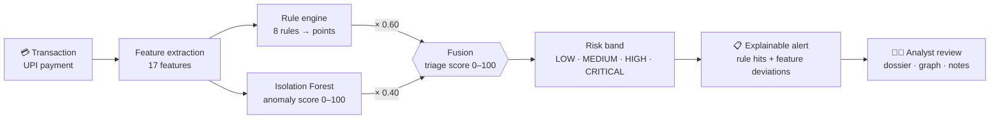
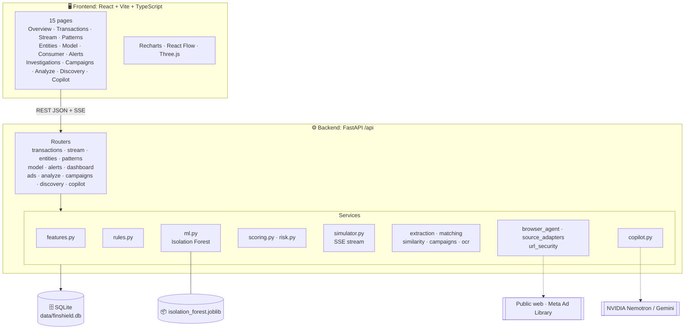

<div align="center">

# 🛡️ FIN-SHIELD

### Explainable UPI fraud triage and scam-advertisement intelligence — in one investigator workspace

<p>
  <a href="https://fin-shield-elej.vercel.app/"></a>
  <a href="#-quick-start"></a>
</p>

<p>
  
  
  
  
  
  
  
  
  
</p>

**[🚀 Live Demo](https://fin-shield-elej.vercel.app/)** · **[✨ Features](#-features)** · **[🏗️ Architecture](#️-architecture)** · **[⚡ Quick Start](#-quick-start)** · **[🔌 API](#-api-reference)** · **[📊 Benchmark](#-benchmark)** · **[⚠️ Limitations](#️-known-limitations)**

</div>

---

> [!IMPORTANT]
> FIN-SHIELD is an **investigation and risk-triage tool**. Scores are a **0–100 triage index** that tells an analyst what to look at first. They are **not** a fraud probability and never declare a person or transaction fraudulent. The bundled dataset is **100% synthetic**.

## 📖 Table of contents

- [Why FIN-SHIELD](#-why-fin-shield)
- [Features](#-features)
- [How it works](#-how-it-works)
- [Architecture](#️-architecture)
- [Tech stack](#-tech-stack)
- [Quick start](#-quick-start)
- [Configuration](#️-configuration)
- [Deployment](#-deployment)
- [Using the app](#-using-the-app)
- [API reference](#-api-reference)
- [Benchmark](#-benchmark)
- [Testing](#-testing)
- [Project structure](#-project-structure)
- [Security and privacy](#-security-and-privacy)
- [Known limitations](#️-known-limitations)
- [Roadmap](#️-roadmap)
- [Team](#-team)

## 🎯 Why FIN-SHIELD

UPI moves money in seconds, so scams that rely on social engineering (fake collect requests, impersonated bank handles, mule accounts) are over before a fixed-threshold rule fires. Analysts also face a second problem: the scam *advertisement* that lured the victim is a separate trail that rarely reaches the payments team.

FIN-SHIELD puts both in one workspace:

| Problem | What FIN-SHIELD does |
| :-- | :-- |
| Fixed rules miss new patterns | Blends a **transparent rule engine (60%)** with an **unsupervised Isolation Forest (40%)** |
| Black-box scores can't be acted on | Every score lists **which rules fired, why, and how many points each added** |
| Fraud rings hide across accounts | An **entity graph** links accounts, UPI handles and shared devices |
| Scam ads and payments are siloed | An **advertisement-intelligence module** extracts entities from ads and links them to the same campaigns |
| Victims get no guidance | A **Consumer Check** gives plain-language advice for a payment before or after it happens |

## ✨ Features

### 💳 UPI transaction risk engine

- **17 engineered features** per transaction: amount and baseline deviation, 1h/24h sender and receiver velocity, new-beneficiary flag, device and IP reuse, collect-request flag, rapid in-out flag, round-number flag, geo mismatch, night/weekend, failed attempts.
- **8 deterministic fraud rules**, each with a severity, an explanation, evidence and a score contribution:

<details open>
<summary><b>The 8 rules</b></summary>

| Rule | Detects | Points |
| :-- | :-- | :-: |
| `FAKE_COLLECT_REQUEST` | Collect/pull request with a deceptive note (lottery, cashback, refund) or a high value | 35 |
| `PHISHING_PAYMENT_HANDLE` | Beneficiary handle imitating a bank, utility or gateway (e.g. `sbi.kyc@paytm`) | 40 |
| `MULE_ACCOUNT_FAN_OUT` | Funds drained out right after arriving (>70% of recent inbound) | 30 |
| `RAPID_REPEATED_TRANSFERS` | 4+ transactions from one sender in an hour | 15 / 22 |
| `NEW_PAYEE_HIGH_VALUE` | First-time beneficiary and ≥ ₹25,000 or ≥ 3.5× the sender's baseline | 25 |
| `DEVICE_SHARING_RING` | One device fingerprint used by 3+ accounts | 25 |
| `GEO_DEVICE_INCONSISTENCY` | Location mismatch during off-hours (23:00–04:59) | 15 |
| `ROUND_AMOUNT_PATTERN` | Exact round figure ≥ ₹20,000 | 10 |

</details>

- **Hybrid score:** `triage = 0.40 × ML anomaly score + 0.60 × min(rule points, 100)`. If the model is unavailable, the score falls back to rule points and says so (`rules_only_fallback`).
- **Risk bands:** `LOW` < 25 · `MEDIUM` 25–49 · `HIGH` 50–74 · `CRITICAL` ≥ 75.
- **Explanations:** per-feature "this amount is 6.1× the account's usual transfer" statements next to the rule hits.

### 🔴 Live stream simulator

A Kafka-style in-memory event stream pushes synthetic payments through the same scoring pipeline and broadcasts them to the browser over **Server-Sent Events**, with `Start / Pause / Resume / Stop / Reset` controls.

### 🕸️ Entity graph and pattern observatory

Interactive 2D and 3D graph of accounts, UPI handles, devices and money flow, plus a pattern view that groups transactions by typology.

### 📢 Advertisement intelligence

- Paste ad text or upload an image (OCR with Tesseract, when installed).
- Regex/rule **entity extraction** (handles, phone numbers, URLs, accounts) and a **0–100 rules-based ad risk score** from scam phrases such as "guaranteed returns", "advance fee" or "share your OTP".
- **Evidence-backed relationships** between ads (shared entities plus TF-IDF text similarity), grouped into **campaigns** by connected components.
- **Autonomous discovery runs** over pluggable sources (public web search via Playwright, a synthetic testbed, Meta Ad Library and social adapters when credentials are configured). Streamed live over SSE.
- URL validation blocks unsafe targets before the discovery agent opens anything.

### 🤖 Investigation copilot

An LLM assistant grounded in the case's stored evidence. **NVIDIA Nemotron** is the primary provider with **Gemini** as an optional fallback. It cites evidence references rather than free-styling.

### 🧑‍⚖️ Analyst workflow

Alerts inbox, slide-over evidence dossier, review states (`Unreviewed → Under Review → Escalated → Closed`) and analyst notes. Review actions never change the stored risk score.

### 🙋 Consumer Check

Describe a payment (handle, amount, note) and get the same rule-based findings translated into plain-language advice.

## 🔬 How it works



**Worked example.** A ₹4,999 collect request noted "cashback" to a first-time payee fires `FAKE_COLLECT_REQUEST` (35). With an ML anomaly score of 60 the triage score is `0.40 × 60 + 0.60 × 35 = 45`, a `MEDIUM` case. Add a phishing-looking handle (+40) and it becomes `0.40 × 60 + 0.60 × 75 = 69`, a `HIGH` case.

## 🏗️ Architecture

FIN-SHIELD is a **modular monolith**: one FastAPI service, one SQLite database, and a React single-page app.



<details>
<summary><b>Data model</b></summary>

`customer_accounts` · `device_fingerprints` · `transactions` · `risk_assessments` · `entity_links` · `stream_runs` for the UPI side; `advertisements` · `extracted_entities` · `risk_signals` · `advertisement_relationships` · `alerts` · `analyst_notes` · `discovery_runs` · `discovery_candidates` for the advertisement side.

</details>

## 🧰 Tech stack

| Layer | Technology |
| :-- | :-- |
| **Backend** | Python 3.12, FastAPI, Uvicorn, SQLAlchemy 2, Pydantic 2, pydantic-settings |
| **ML** | scikit-learn `IsolationForest` + `RobustScaler`, NumPy, joblib |
| **Frontend** | React 18, TypeScript, Vite, Tailwind CSS, React Router, Recharts, React Flow (`@xyflow/react`), Three.js / React Three Fiber |
| **Data** | SQLite, synthetic generator for Indian-style UPI topologies |
| **AI / automation** | NVIDIA Nemotron (OpenAI-compatible API), Gemini fallback, Playwright, optional Tesseract OCR |
| **Testing** | pytest (57 tests) |
| **Hosting** | Frontend on Vercel |

## ⚡ Quick start

**Prerequisites:** Python 3.12 · Node.js 20+ · Git

```bash
# 1. Clone
git clone https://github.com/Jenishjain12/FinShield.git
cd FinShield

# 2. Backend: install, seed, run  (http://localhost:8000/docs)
cd backend
python3.12 -m venv .venv
source .venv/bin/activate            # Windows: .venv\Scripts\activate
pip install -r requirements.txt
cp .env.example .env                 # Windows: copy .env.example .env
python seed.py                       # synthetic data + trains the anomaly model
uvicorn app.main:app --reload --port 8000

# 3. Frontend (new terminal)  (http://localhost:5173)
cd frontend
npm install
npm run dev
```

Open **http://localhost:5173**. Vite proxies `/api` and `/uploads` to the backend on port 8000, so no frontend config is needed locally.

> [!TIP]
> Run `python seed.py` **before** your first demo. It trains the Isolation Forest on the 17-feature vector. Afterwards, open `/api/model/status` (or the **Model** page) and confirm the hybrid score is active rather than `rules_only_fallback`.

<details>
<summary><b>Optional extras</b></summary>

**Image OCR for the Analyze page.** Install the Tesseract binary and `pytesseract`:

```bash
# macOS
brew install tesseract
# Ubuntu / Debian
sudo apt install tesseract-ocr
pip install pytesseract
```

Without it the app still works: text analysis runs and the UI reports that OCR is unavailable.

**Autonomous web discovery.** Install the Playwright browser once:

```bash
playwright install chromium
```

**AI copilot.** Add `NVIDIA_API_KEY` (and optionally `GEMINI_API_KEY`) to `backend/.env`. Without a key the copilot reports itself as unconfigured.

**Benchmark reproduction.** `pip install -r requirements-eval.txt` then `python eval_model.py`.

</details>

## ⚙️ Configuration

Backend settings live in `backend/.env` (see `.env.example`).

| Variable | Default | Purpose |
| :-- | :-- | :-- |
| `DATABASE_URL` | `sqlite:///../data/finshield.db` | Database connection |
| `CORS_ORIGINS` | `http://localhost:5173,http://127.0.0.1:5173` | Comma-separated allowed frontend origins |
| `SIMILARITY_THRESHOLD` | `0.72` | Minimum text similarity to link two ads |
| `NVIDIA_API_KEY` | none | Enables the Nemotron copilot |
| `NVIDIA_MODEL` / `NVIDIA_BASE_URL` | `nvidia/nemotron-3.5-lightning-30b-a3b` / `https://integrate.api.nvidia.com/v1` | Copilot model and endpoint |
| `GEMINI_API_KEY` / `GEMINI_MODEL` | none / `gemini-3.8-flash` | Optional fallback copilot |

Frontend setting (build time):

| Variable | Default | Purpose |
| :-- | :-- | :-- |
| `VITE_API_BASE_URL` | empty (same origin, via Vite proxy) | Backend URL for deployed builds |

## 🌐 Deployment

The live frontend is hosted on Vercel: **https://fin-shield-elej.vercel.app/**

The frontend is a static build and needs a reachable backend:

1. Deploy `backend/` to any host that runs Python (Render, Railway, Fly.io, a VM). Start command: `uvicorn app.main:app --host 0.0.0.0 --port $PORT`.
2. Run `python seed.py` once on the host so the database and model exist.
3. On the backend set `CORS_ORIGINS=https://fin-shield-elej.vercel.app`.
4. In Vercel set `VITE_API_BASE_URL=https://<your-backend-host>` and redeploy.

> [!NOTE]
> SQLite and uploaded files live on local disk. On hosts with ephemeral storage, re-seed after each restart or mount a persistent volume.

## 🧭 Using the app

| Page | Route | What you do there |
| :-- | :-- | :-- |
| **Overview** | `/` | Dashboard metrics and the highest-risk queue |
| **Transactions** | `/transactions` | Filter scored payments; open one for its full dossier |
| **Live Stream** | `/stream` | Start the simulator and watch payments get scored in real time |
| **Patterns** | `/patterns` | Browse fraud typologies and their transactions |
| **Entities** | `/entities` | 2D/3D graph of accounts, handles and devices |
| **Model** | `/model` | Model status, feature list and benchmark results |
| **Consumer Check** | `/consumer` | Check a payment and get plain-language advice |
| **Alerts** | `/alerts` | Triage the alert inbox |
| **Investigations** | `/investigations` | Scam-ad cases with evidence and notes |
| **Campaigns** | `/campaigns` | Clusters of linked ads |
| **Analyze** | `/analyze` | Submit ad text or an image for analysis |
| **Discovery** | `/discovery` | Run autonomous ad discovery from selected sources |
| **Copilot** | `/copilot` | Ask questions about a case, grounded in its evidence |

### 🎬 Suggested 3-minute demo

1. **Overview**: show the risk-band split and the top alerts.
2. **Transactions**: open a `CRITICAL` payment and read the rule hits and feature explanations.
3. **Entities**: expand a device shared by several accounts to show a ring.
4. **Analyze**: paste a "guaranteed returns, pay a registration fee" ad and see the risk signals and linked campaign.
5. **Consumer Check**: enter a collect request noted "cashback" and read the advice.

## 🔌 API reference

Base URL (local): `http://localhost:8000` · Interactive docs: **`/docs`** (Swagger) · All routes are under `/api`.

<details>
<summary><b>UPI risk</b></summary>

| Method | Path | Purpose |
| :-: | :-- | :-- |
| GET | `/api/health` | Liveness check |
| GET | `/api/dashboard/summary` | Dashboard metrics |
| GET | `/api/transactions` | Paginated, filterable transactions |
| GET | `/api/transactions/{id}` | Transaction with score, rule hits, explanations |
| POST | `/api/transactions` · `/api/transactions/ingest` | Add a transaction and score it |
| POST | `/api/transactions/score` | Score without storing |
| POST/PATCH | `/api/transactions/{id}/review` | Set review state |
| POST | `/api/transactions/{id}/notes` | Add an analyst note |
| POST | `/api/consumer/check` | Plain-language advice for a described payment |
| GET | `/api/patterns` · `/api/patterns/{id}/transactions` | Typologies and their transactions |
| GET | `/api/network/graph` | Entity graph |
| GET | `/api/entities/account/{id}` · `/api/entities/device/{id}` | Entity detail |
| GET | `/api/alerts` · PATCH `/api/alerts/{id}` | Alert inbox |
| GET | `/api/model/status` · `/api/model/evaluation` | Model state and benchmark |
| POST | `/api/model/train` · `/api/dataset/generate` | Retrain / regenerate synthetic data |

</details>

<details>
<summary><b>Stream simulator</b></summary>

| Method | Path | Purpose |
| :-: | :-- | :-- |
| GET | `/api/stream/status` | Current state |
| POST | `/api/stream/start` · `pause` · `resume` · `stop` · `reset` | Lifecycle controls |
| GET | `/api/stream/events` | **SSE** feed of scored transactions |

</details>

<details>
<summary><b>Advertisement intelligence</b></summary>

| Method | Path | Purpose |
| :-: | :-- | :-- |
| POST | `/api/analyze` | `multipart/form-data`: `text`, `source`, `source_url`, `image` |
| GET | `/api/ads` · `/api/ads/{id}` | Investigations list and detail |
| GET | `/api/ads/{id}/relationships` | Evidence-backed links |
| PATCH | `/api/ads/{id}/review` | Review state |
| POST | `/api/ads/{id}/notes` | Analyst note |
| GET | `/api/campaigns` · `/api/campaigns/{id}` | Connected clusters |
| GET | `/api/discovery/sources` | Available sources |
| POST/GET | `/api/discovery/runs` | Start and list discovery runs |
| GET | `/api/discovery/runs/{id}` · `/stream` | Run detail and live SSE progress |
| GET | `/api/copilot/status` · POST `/api/copilot/message` | Copilot |

</details>

Example:

```bash
curl -X POST http://localhost:8000/api/consumer/check \
  -H "Content-Type: application/json" \
  -d '{"amount": 4999, "receiver_upi_handle": "sbi.kyc@paytm", "transaction_type": "collect", "reference_note": "cashback"}'
```

> Request schemas are in `backend/app/schemas/transaction.py`, and `/docs` shows the exact fields for every route.

## 📊 Benchmark

Held-out evaluation on **5,000 synthetic transactions** (3,500 train / 1,500 test, 10% fraud prevalence, seed 42). Reproduce with `python eval_model.py`. Results are saved in `backend/data/eval_results.json` and `docs/EVALUATION.md`.

| Detector | ROC-AUC | PR-AUC | Precision@10% |
| :-- | :-: | :-: | :-: |
| Rules only | 0.909 | 0.794 | 78.0% |
| Isolation Forest | 0.900 | 0.755 | 68.0% |
| **Hybrid (0.4 ML + 0.6 rules)** | **0.923** | **0.858** | **80.7%** |
| Supervised XGBoost (reference) | 0.944 | 0.905 | 86.7% |

**How to read this.** The hybrid beats both of its parts, which is the reason for fusing them. A supervised model trained on labels still scores higher, which is expected since it sees the answers. The data is synthetic and generated by the same rules family, so these numbers show the pipeline works. They are **not** real-world accuracy. Velocity bursts are a known weak spot (≈0% recall@10% in the benchmark).

## 🧪 Testing

```bash
cd backend
source .venv/bin/activate
pytest                    # 57 tests

cd ../frontend
npm run build             # type-check + production build
```

56 of 57 backend tests pass in an offline sandbox. `test_valid_public_urls` needs live DNS and fails without network access.

## 📁 Project structure

```text
FinShield/
├── backend/
│   ├── app/
│   │   ├── api/          # FastAPI routers (13 modules)
│   │   ├── core/         # settings (config.py)
│   │   ├── db/           # SQLAlchemy base and session
│   │   ├── models/       # ORM models
│   │   ├── schemas/      # Pydantic schemas
│   │   ├── services/     # features, rules, ml, scoring, simulator, extraction,
│   │   │                 # matching, campaigns, ocr, copilot, discovery agent
│   │   └── main.py       # app, CORS, router registration
│   ├── data/             # isolation_forest.joblib, eval_results.json
│   ├── tests/            # pytest suite
│   ├── seed.py           # generate synthetic data and train the model
│   └── eval_model.py     # reproducible benchmark
├── frontend/
│   └── src/
│       ├── pages/        # 15 route pages
│       ├── components/   # dossier, graph, risk gauge, UI primitives
│       ├── services/     # typed API client
│       └── contexts/     # theme
├── data/                 # finshield.db, uploads/
└── docs/                 # architecture.md, api.md, EVALUATION.md, DEVELOPMENT_STATUS.md
```

## 🔒 Security and privacy

- **Synthetic data only.** No real customer, account or payment data is used.
- **No blind URL fetching.** User-supplied URLs are parsed as text; the discovery agent validates targets through `url_security` first.
- **Upload limits.** Images must be JPEG/PNG/WebP and at most 5 MB, and are never executed.
- **Secrets stay out of git.** `.env` is git-ignored; only `.env.example` is committed.
- **Human in the loop.** Scores prioritise review. Only an analyst's review state changes a case's status.

## ⚠️ Known limitations

We would rather you hear these from us:

- **Prototype storage.** SQLite and an in-memory stream are chosen for demo speed, not scale.
- **Synthetic benchmark.** Metrics measure the pipeline on generated data, not real-world fraud.
- **Model artifact needs a retrain.** The `isolation_forest.joblib` committed in the repo was fitted on 13 features while the code expects 17. When that happens the app safely falls back to rules-only scoring (all 580 stored assessments are `rules_only_fallback`). Run `python seed.py` and confirm `/api/model/status` to enable the hybrid score.
- **Velocity bursts** are poorly caught by the current rules and model.
- **Dataset size.** The shipped database holds 45 accounts and 580 transactions.
- **OCR** needs Tesseract installed; **copilot** needs an API key; **web discovery** needs Playwright's browser.
- `docs/EVALUATION.md`'s leave-one-typology-out conclusion is stronger than its own table supports; treat it as unproven.

## 🗺️ Roadmap

- [ ] Real-time ingestion via Kafka or Redpanda instead of the in-memory stream
- [ ] PostgreSQL, and a graph store for large entity networks
- [ ] Velocity and sequence features (time-windowed, per-pair)
- [ ] Feedback loop: analyst dispositions retrain and calibrate the model
- [ ] Authentication and role-based access for analysts
- [ ] Integration with real UPI/NPCI risk signals under proper data agreements

## 👥 Team

**Team Synapse**

| Member | GitHub |
| :-- | :-- |
| Jenish Jain | [@Jenishjain12](https://github.com/Jenishjain12) |
| Saksham Jain | [@jn-saksham22](https://github.com/jn-saksham22) |
| Ritik Shekhawat | [@ritikshekhawat087-ops](https://github.com/ritikshekhawat087-ops) |
| Mohit Suthar | [@Mohit-Suthar121](https://github.com/Mohit-Suthar121) |


<div align="center">

Built for explainable, human-in-the-loop fraud investigation. 🛡️

</div>
